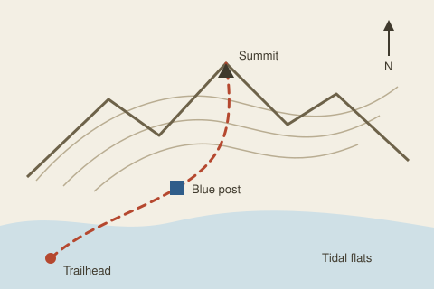

# Field guide

Download the [map](<https://example.org/map>)

- Pack a notebook.
- Bring water.

1. Find the trail.
   ```
   survey --offline
   ```
2. Follow the signs.
   - Look for blue posts.

***

> 
>
> Record the trail conditions.
